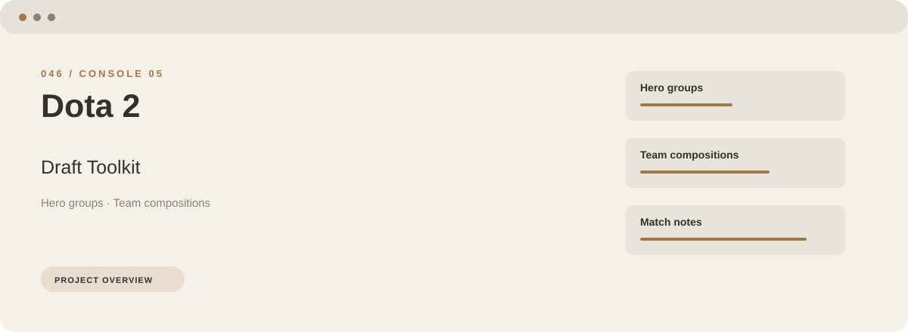
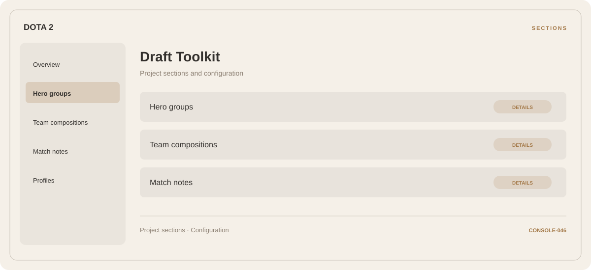

# ⚡ Dota 2 Draft Toolkit

**Hero groups · Team compositions · Match notes**

## ⚡ Features

Start with hero groups, organize team compositions, and keep match notes close at hand. These are the main areas covered by Dota 2 Draft Toolkit.

### ⚙️ Hero groups

Character or team groups presented with the context needed to organize a session.

### 🧩 Team compositions

Character or team groups presented with the context needed to organize a session.

### ⌨️ Match notes

Session and activity information grouped by the task or context it belongs to.

## 🖥️ Project navigation

## 📥 Download

The button and cover open the project's download page. Use the information supplied with the downloaded package for installation and release-specific requirements.

## 📚 Project documentation

- [Feature reference](docs/FEATURES.md)
- [Download information](docs/DOWNLOAD.md)
- [Project page](index.html)

---

Dota 2 Draft Toolkit · Program documentation and download information.
